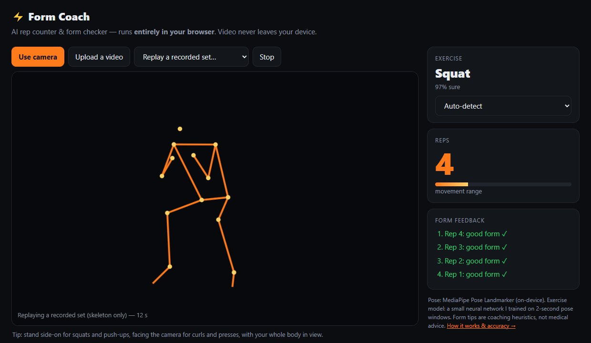
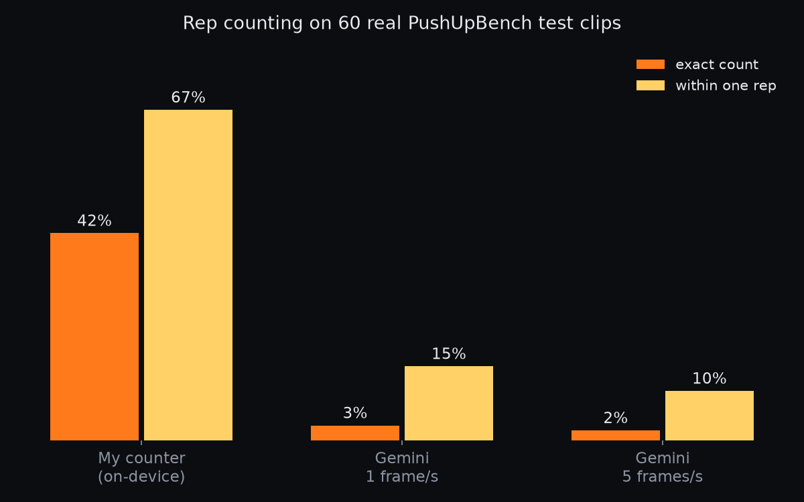

# Form Coach

**An AI rep counter and form checker that runs entirely in your browser.** Point your camera at yourself (or upload a video): it recognises the exercise, counts your reps and gives a form tip after every rep — "go deeper", "keep your body in a straight line", "keep your elbows by your sides". The video never leaves your device.

**▶ Live demo: https://omar122211.github.io/form-coach/**

Built as the coaching brain for **Forge**, my Android fitness app (which counts reps with on-device pose detection) — this repo is the open, testable version of that idea.



## How it works

```
camera / video
   │  MediaPipe Pose Landmarker (on-device, WebAssembly/GPU)  →  33 body points in 3D, 10× per second
   ▼
features: 8 joint angles (elbows, shoulders, hips, knees) + torso lean + body line + 13 body-relative points
   │
   ├─► exercise classifier — a small neural network I trained on 2-second windows     → squat / push-up / curl / press
   ├─► rep counter — one up-and-down signal + two adaptive thresholds (hysteresis)    → reps
   └─► form rules — joint angles at the bottom / top of each rep                       → coaching cues
```

- **Same code path in Python and JavaScript.** Training and evaluation run in Python; the demo re-implements the features, classifier, counter and rules in plain JavaScript (`docs/coach.js`). A parity test runs both on the same poses and requires identical numbers.
- **No server, no tracking:** the page loads its scripts, the WebAssembly runtime and the models from this repo only, under a strict Content Security Policy.
- **Privacy-preserving demo data:** the "replay a recorded set" option plays back *skeleton coordinates only* — no one's video is redistributed.
- The page's Content Security Policy even blocks MediaPipe's own usage logging to Google (`odml.pa.googleapis.com`) — nothing at all leaves the browser.
- **Uploaded videos are analysed frame by frame at exactly 10 fps**, so results match the evaluation on any device; the live camera counter works on timestamps, so a slow phone still behaves the same.

## Results

All test data below was **never used for training or tuning**.

### Exercise recognition — 40 real videos (10 per exercise), split by video

| Model (input: 2-second pose window) | Videos correct | 2-second windows correct |
|---|---|---|
| Logistic regression on window statistics | 92.5 % | 80.1 % |
| **MLP (64 hidden units) on window statistics** — runs in the browser | **97.5 % (39/40)** | **87.3 %** |
| 1D-CNN over the raw window | 92.5 % | 82.4 % |
| Same MLP, trained on synthetic avatars only | 80.0 % | 69.7 % |

The smallest neural network won — with ~450 training videos, the CNN overfits. Adding just 12 real videos per exercise to 400 synthetic ones lifted real-video accuracy from 80 % to 97.5 %. (Small test set: 40 videos.)

### Rep counting — PushUpBench (real clips, dozens of exercise types)

The counter's settings were chosen on a fixed 30 % "dev" slice (60 clips) and are reported on the other 167 clips.

| On 167 test clips | Exact | Off-by-one | Mean abs. error |
|---|---|---|---|
| **My counter** (pose → main movement → detrend → hysteresis) | **38.3 %** | **64.7 %** | **5.4 reps** |
| Same, without detrending | 28.7 % | 46.7 % | 8.3 |
| Baseline: always guess the typical count (12) | 12.0 % | 28.7 % | 8.1 |

**Against an LLM** — the same 60 test clips sent to Gemini 3.5 Flash-Lite as video ("count the repetitions of *X*"):

| On the same 60 clips | Exact | Off-by-one | Mean abs. error | Time per clip |
|---|---|---|---|---|
| **My counter** | **42 %** | **67 %** | **5.6** | < 1 s, on-device |
| Gemini, API default (1 frame/s) | 3 % | 15 % | 13.7 | 8.7 s |
| Gemini, 5 frames/s | 2 % | 10 % | 11.3 | 12.2 s |



This matches the PushUpBench paper's point — *general video models are not good at counting reps* — and is why Forge counts reps with pose estimation on the phone instead of sending video to an AI service. Where my counter fails: very fast moves (high knees, mountain climbers at ~2 reps/s) and alternating left/right moves, which it often counts as half.

### Rep counting — the four demo exercises (400 synthetic videos with exact per-frame rep counts)

| | Squat | Shoulder press | Biceps curl | Push-up | All |
|---|---|---|---|---|---|
| Exact | 96 % | 85 % | 70 % | 33 % | 71 % |
| Off-by-one | 97 % | 96 % | 84 % | 59 % | 84 % |

Push-ups are the weak spot: the pose model loses the body more often when it is horizontal (in 6 of 100 clips it barely found it at all).

### Form cues — calibrated, then checked for false alarms

Single-camera 3D pose under-reads deep joint angles (a full curl reads ~85°, not ~40°), so textbook thresholds would flag almost every correct rep. Instead, each rule's threshold is **calibrated on real videos of trainers** in the training split (only ~10 % of their reps may trigger it), and checked on trainers' reps from the test split:

| Exercise | Correct reps that still got a cue (held-out trainer videos) |
|---|---|
| Shoulder press | 9.8 % of 51 reps |
| Push-up | 12.5 % of 16 reps |
| Squat | 20.5 % of 39 reps |
| Biceps curl | 1 of 3 reps (too few to judge) |

What this does *not* measure is how often real mistakes are caught — that would need videos labelled by a coach.

## Data

| Dataset | Used for | Licence |
|---|---|---|
| [Real-Time Exercise Recognition Dataset](https://huggingface.co/datasets/RickyRiccio/Real_Time_Exercise_Recognition_Dataset) — 100 real videos + 400 synthetic [InfiniteRep](https://toinfinity.ai/) avatar videos | training / testing the exercise classifier; synthetic videos also have exact per-frame rep counts | see source |
| [PushUpBench](https://huggingface.co/datasets/anonymousatom/pushupbench) — 227 real exercise clips with human rep counts | rep-counting benchmark | CC BY 4.0 |

Videos are downloaded by `coach/data_prep.py` and never committed. The classifier test set is **real videos only**, never seen in training (split by video).

## Run it

```bash
python -m venv .venv && .venv\Scripts\activate
pip install torch==2.15.0 --index-url https://download.pytorch.org/whl/cpu
pip install -r requirements.txt
pytest                                   # offline tests incl. Python ↔ JavaScript parity (needs Node for that part)

python -m coach.data_prep                # ~4 GB of videos
python -m coach.extract_all pushupbench  # pose landmarks, one video per CPU core
python -m coach.extract_all exercises
python -m coach.train_classifier         # → docs/model.json for the browser
python -m coach.calibrate_form           # form-rule thresholds from trainer videos → docs/form_thresholds.json
python -m eval.reps_eval                 # rep counting on PushUpBench + synthetic videos
python -m eval.gemini_reps --n 60        # optional: same clips counted by Gemini (needs a free key in .env)

python -m http.server -d docs 8000       # demo at http://localhost:8000 (camera needs localhost or https)
```

## Project layout

```
coach/
  pose.py              MediaPipe Pose Landmarker over a video (world landmarks, 10 fps)
  features.py          joint angles, posture and body-relative positions
  train_classifier.py  logistic regression vs MLP vs 1D-CNN; exports the MLP to docs/model.json
  reps.py              rep signal + detrending + hysteresis counter
  form.py              per-rep coaching rules
  calibrate_form.py    sets each rule's threshold from real trainer videos
  make_samples.py      skeleton-only replays for the demo
docs/                  the live demo (GitHub Pages): index.html, app.js, coach.js, model.json, vendored MediaPipe
eval/                  rep-counting and Gemini comparison scripts + results
tests/                 unit tests + Python ↔ JavaScript parity tests (+ replay_check.mjs: the demo pipeline in Node)
```

## Limits

- Four exercises for recognition; the counter itself works on any repetitive movement but struggles with alternating left/right moves (it may count each side as one rep or both as one).
- Form cues are coaching heuristics with fixed angle thresholds, not a medical or physiotherapy tool, and they haven't been validated against coach labels.
- Pose estimation from one camera is weakest when limbs are hidden — side-on works best for squats and push-ups.

## Built with

Python · PyTorch · scikit-learn · MediaPipe · NumPy · OpenCV · JavaScript (ES modules, Canvas, WebAssembly) · Google Gemini API (comparison only) · pytest
